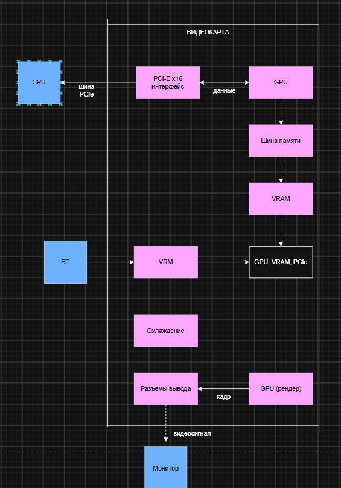

# Часть №1. Теория, краткие ответы

## 1. 5 основных блоков видеокарты

- **GPU (графический процессор)** — выполняет вычисления (шейдеры, рендеринг).
- **VRAM (видеопамять)** — хранит текстуры, кадры, буферы.
- **Подсистема питания (VRM)** — преобразует и стабилизирует напряжение для GPU и памяти.
- **Система охлаждения** — отводит тепло от GPU, VRAM и VRM.
- **Плата (PCB) с интерфейсами** — соединяет компоненты, обеспечивает PCIe и видеовыходы.

---

## 2. GPU vs CPU

- **Ядра:** CPU — мало мощных универсальных ядер; GPU — тысячи простых ядер.
- **Параллелизм:** CPU оптимизирован для последовательных задач с ветвлениями; GPU — для массовых однотипных параллельных вычислений.
- **CPU выгоден** для ОС, логики, баз данных; **GPU**: для графики, нейросетей, рендеринга.

---

## 3. VRAM vs ОЗУ

- **VRAM** — память на видеокарте, хранит текстуры, кадры, шейдерные данные.  
- **ОЗУ** — общая память для CPU.
- VRAM быстрее, потому что GPU обрабатывает огромные объёмы данных параллельно — узкое место иначе было бы в памяти.

---

## 4. SIMT и варпы

- **SIMT** — одна инструкция выполняется множеством потоков одновременно (каждый над своими данными).
- **Варп** — группа потоков (обычно 32), выполняющихся синхронно на одном блоке.  
  Группировка нужна для эффективного использования конвейера: все потоки варпа идут вместе, маскируя задержки.

---

## 5. Охлаждение и питание

- **Охлаждение** отводит тепло от GPU/VRAM/VRM; питание даёт стабильное напряжение и ток.
- Если охлаждение не справится — троттлинг (снижение частот), перегрев, артефакты, зависания, в пределе = повреждение чипа.

---
# Часть №2. Схема

---
# Часть №3. Практическая часть

## Задание №7
| Параметр | Значение для Intel UHD Graphics / i5-12450H |
| :--- | :--- |
| **Модель видеокарты** | Intel(R) UHD Graphics (встроенная в процессор) |
| **Объём VRAM** | Своей нет. Использует системную ОЗУ. В dxdiag выделено 128 МБ, общий доступный объём — 8181 МБ (около 8 ГБ). |
| **Тип памяти** | Системная оперативная память (DDR4 или DDR5 в зависимости от материнской платы ноутбука). |
| **Ширина шины** | Своей шины нет. Зависит от режима работы ОЗУ (одноканальный/двухканальный). |
| **Число ядер (шейдерных)** | 48 исполнительных блоков (Execution Units / EU). |
| **TDP** | Отдельного TDP нет, так как это часть процессора. Энергопотребление входит в общий TDP CPU (базовый 45 Вт). |

---

## Задание №8
У моей видеокарты Intel UHD Graphics нет собственной видеопамяти, поэтому расчет по формуле не применим. Она использует оперативную память компьютера объемом 16 ГБ, которая работает на частоте 3200 МГц (это стандарт для ноутбуков с DDR4)

---

## Задание №9
*Так как в моем ноутбуке используется встроенная видеокарта и общая оперативная памятб, процесс выглядит следующим образом:*

1. **Обработка логики:** после нажатия кнопки «Играть» процессор загружает файлы игры с накопителя в оперативную память и берет на себя всю игровую логику

2. **Подготовка ресурсов:** Поскольку у встроенной видеокарты нет своей отдельной видеопамяти, все текстуры, модели и шейдеры загружаются в общую оперативную память ноутбука. Процессор формирует команды для отрисовки кадра и отправляет их видеокарте.

3. **Рендеринг:** Встроенная графика получает команды и начинает строить кадр. Ей приходится постоянно обращаться к общей оперативной памяти, чтобы прочитать текстуры. Из-за того, что процессор и видеокарта используют одну и ту же память, между ними возникает конкуренция. Если оперативной памяти не хватает или она работает медленно, видеокарта простаивает

4. **Вывод на экран:** Готовый кадр помещается в буфер в оперативной памяти и через встроенный видеовыход отправляется на матрицу экрана ноутбука

---
# Часть №4. Вывод

Ии работает на огромном количестве простых математических действий, которые нужно делать одновременно. Процессор имеет мало ядер и решает задачи по очереди, а видеокарта состоит из тысяч маленьких ядер. Поэтому видеокарта может перемалывать тысячи чисел разом. Для ИИ это идеально, потому что вместо того чтобы считать всё медленно и по шагам, видеокарта делает миллионы одинаковых вычислений за один раз. Именно поэтому видеокарты так хорошо справляются с обучением нейросетей.