# 10 практических заданий по BIOS/UEFI

## Задача 1. Включение аппаратной виртуализации (Intel VT-x / AMD-V)

*Виртуализация на устройстве Lenovo*
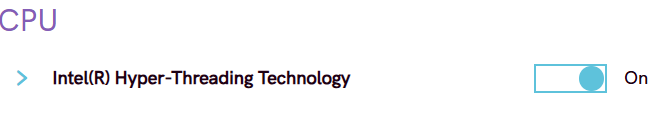

---
## Задача 2. Проверка статуса TPM и его связь с BitLocker

*путь к TPM*

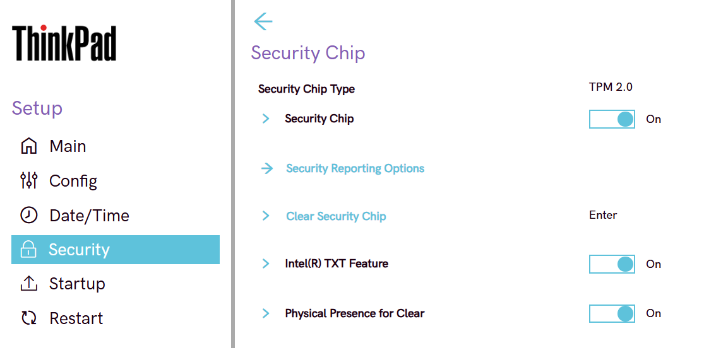

---
## Задача 3. Настройка поведения при потере питания (After Power Loss)

*На моей версии Think Pad отсутсвует эта опция*

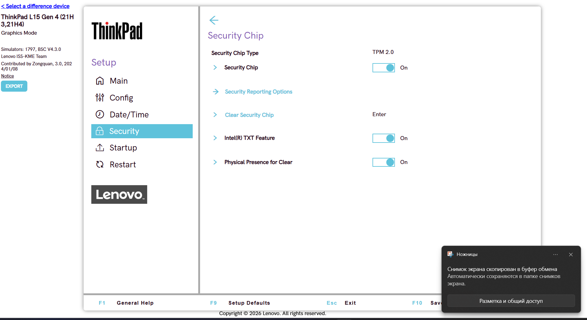

---
## Задача 4. Отключение Secure Boot и проверка последствий

*Отключение и включение security boot (может понадобиться для загрузки с неподписанного USB или установка некоторых версий Linux)*

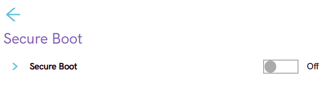
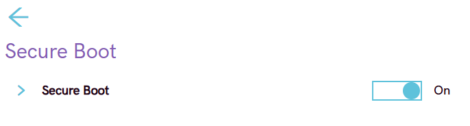

---
## Задача 5. Настройка порядка загрузки через Fast Boot

*Отсутствует на моей версии, но Fast Boot ускоряет загрузку, пропуская инициализацию устройств, из‑за этого BIOS на Lenovo может не успеть увидеть флешку*

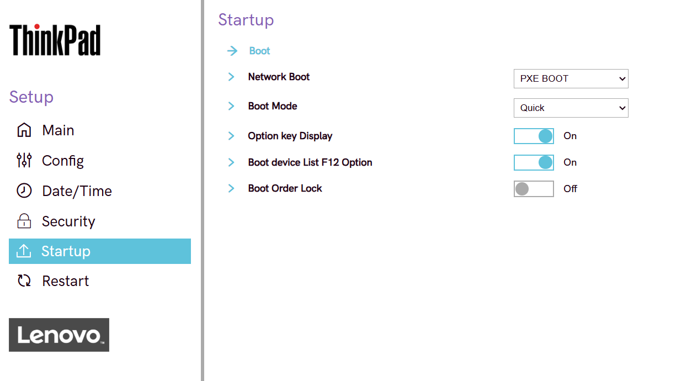
---
## Задача 6. Установка пароля на включение (Power-On Password)

*Пароль был поставлен и убран. При перезапуске леново попросили ввести пароль*

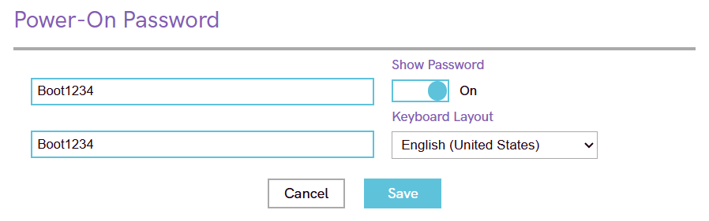

----
## Задача 7. Настройка SATA Controller Mode для установки ОС

*Отсутствует на моей версии, но Windows не загружается после смены режима SATA, потому что в системе нет нужного драйвера для нового режима то диск становится недоступным на раннем этапе загрузки*

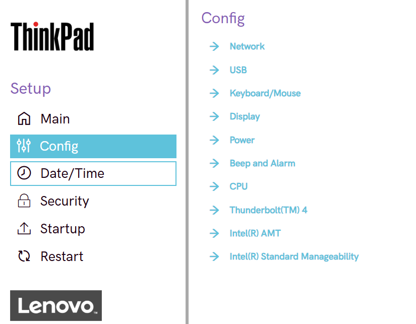

---
## Задача 8. Просмотр и очистка системного журнала событий (Event Log)

*Журналы в Linux в /var/log/ или через journalctl, перед передачей устройства журналы стоит очистить, чтобы не раскрыть личные данные, например логины, IP адреса, пути к файлам и историю подключений*

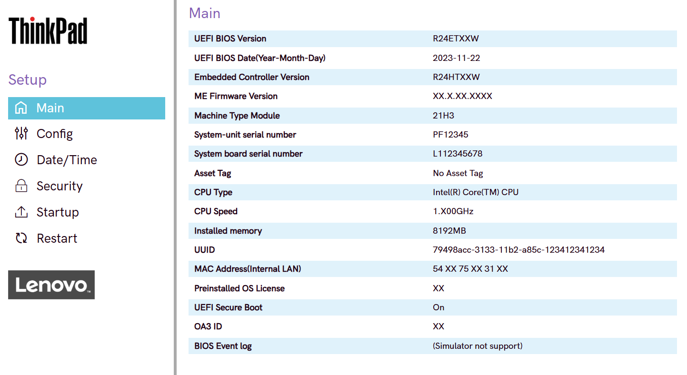

----
## Задача 9. Восстановление заводских настроек с сохранением пользовательских данных

- *Load Factory Defaults используют когда нужно быстро вернуть настройки BIOS/UEFI к заводским, например если что‑то неверно настроено или система не стартует из‑за параметров. При этом ОС и файлы на диске остаются нетронутыми*

- *Полный сброс системы применяют когда надо удалить все личные данные и вернуть устройство к состоянию как из коробки в том числе перед продажей или передачей другому человеку*

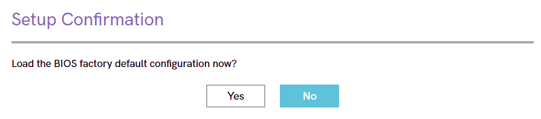

---
## Задача 10. Полный сценарий: подготовка нового сотрудника (IT-администратор)

*Шаг 1. Включить аппаратную виртуализацию*

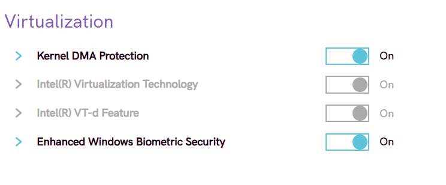

*Шаг 2. Включить TPM*

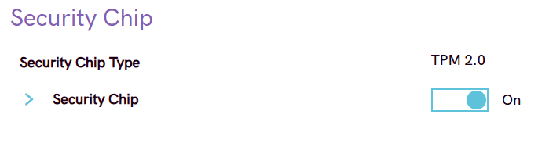

*Шаг 3. Установить Power-On Password*

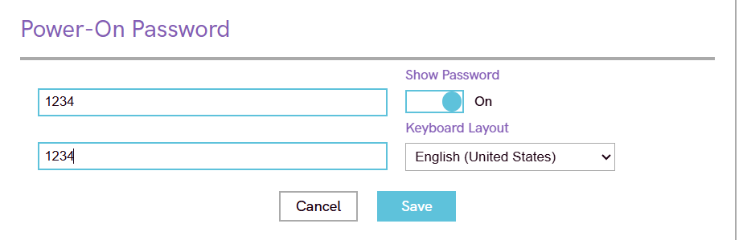

*Шаг 4. Отключить Fast Boot (Отсутствует на моей версии)*

*Шаг 5. Настроить After Power Loss → Power On*

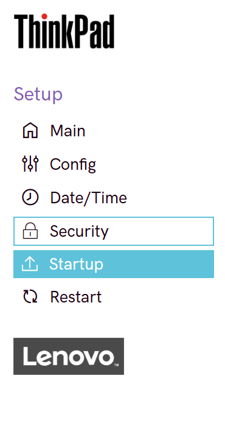

*Шаг 6. Сохранить, проверить, откатить*

все выполнено
