# 10 задач для отработки BIOS/UEFI в Lenovo BIOS Simulator Center

## Задача 1. Навигация по основным разделам
*Отображаемая информация в main:*
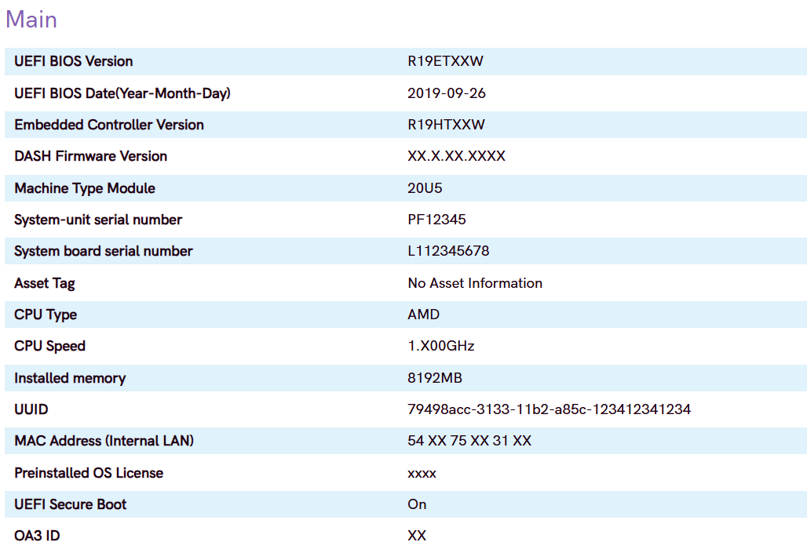

---

## Задача 2. Смена порядка загрузки
*Перестановка приоритетов загрузочных устройств:*
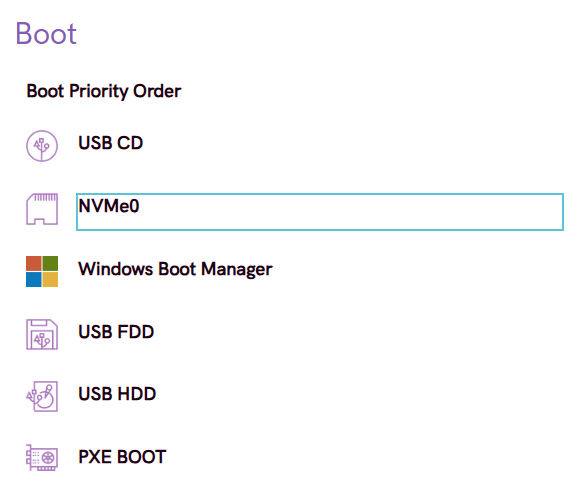

---

## Задача 3. Включение/выключение Secure Boot

*Смена статуса*
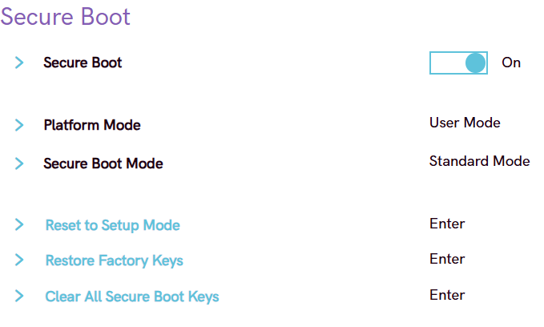
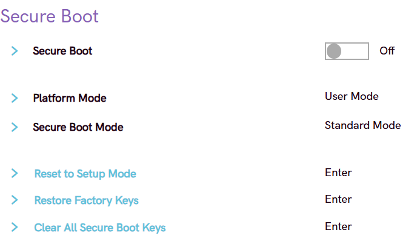

---

## Задача 4. Установка пароля супервизора
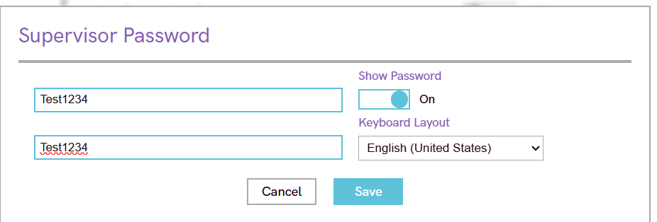

---

## Задача 5. Сброс на заводские настройки

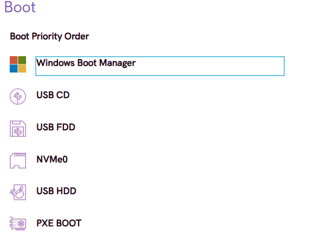

---

## Задача 6. Управление встроенными устройствами
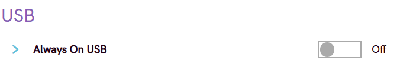
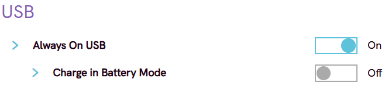

---

## Задача 7. Режим работы SATA/NVMe
на этой версии такой настройки не нашлось

---

## Задача 8. Временное меню загрузки (эмуляция F12)
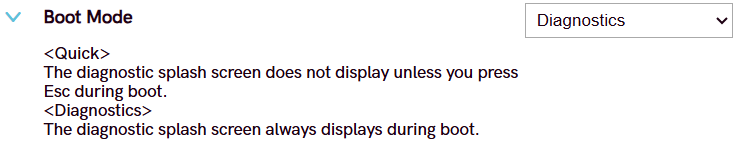
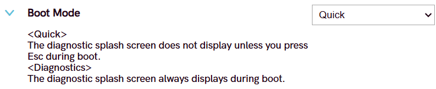

---

## Задача 9. Просмотр системных логов
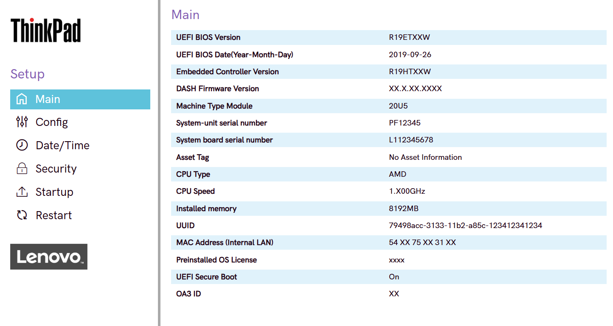
на этой версии не поддерживается

---

## Задача 10. Полный сценарий: подготовка к переустановке ОС
1. нажала f9
2. 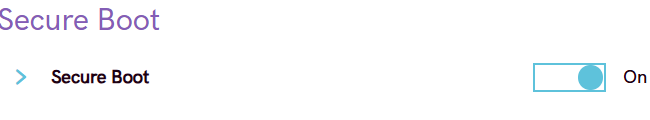
3. 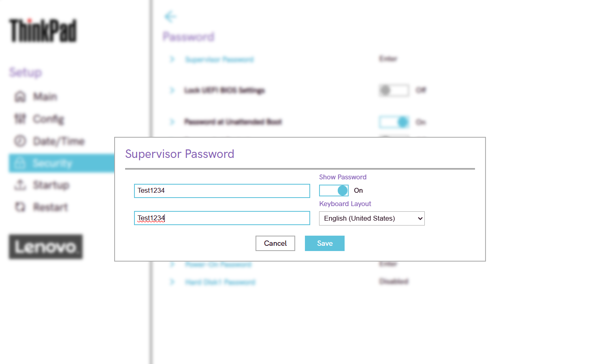
4. 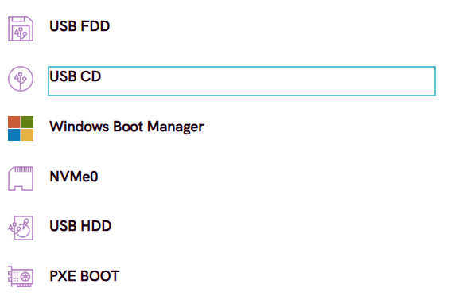
5. F10 нажала
6. Выполнен повторный вход - система запросила пароль. Настройки Secure Boot и порядок загрузки проверены